# Avance 3 — Capítulo III: implementación de Paway

Paway es un prototipo académico de gestión de envíos con Spring Boot, Spring MVC, Thymeleaf y PostgreSQL. Integra cotización, administración, historial del cliente, rastreo y reclamaciones. Este capítulo documenta la aplicación ejecutable de `Paway/`, no las páginas estáticas del primer avance ni los laboratorios independientes.

## 3.4 Diagrama de base de datos relacional



[Fuente Mermaid del modelo](modelo-relacional.mmd). Las cinco tablas corresponden a [`V1__create_schema.sql`](../../src/main/resources/db/migration/V1__create_schema.sql); [`V2__seed_demo_data.sql`](../../src/main/resources/db/migration/V2__seed_demo_data.sql) incorpora los registros de demostración.

| Tabla | Responsabilidad y relaciones |
|---|---|
| `customer` | Cliente remitente; documento y correo únicos. Un cliente puede tener muchos envíos. |
| `agency` | Agencia de origen; nombre único. Una agencia puede ser origen de muchos envíos. |
| `shipment` | Envío: destinatario, destino, peso, cantidad, importe, estado y versión. Cada envío pertenece a un cliente y una agencia; su guía es única. |
| `shipment_event` | Historial de estados del envío, ordenado por fecha e identificador. Cada evento pertenece a un envío. |
| `complaint` | Hoja de reclamación y su respuesta; token y número de hoja únicos. La guía es texto opcional, **no una clave foránea a `shipment`**. |

Los identificadores y números de guía/hoja utilizan identidades o secuencias de PostgreSQL. Las claves foráneas impiden referencias inexistentes. Los `CHECK` restringen documentos, estados, categorías, importes y cantidades; los formularios y entidades también aplican Bean Validation. El peso admite de 0.01 a 1000 kg y la cantidad de 1 a 100 paquetes.

Flyway controla la evolución del esquema; Hibernate usa `ddl-auto=validate`, no crea ni modifica tablas automáticamente. `ShipmentEntity.version` implementa bloqueo optimista con `@Version`. La anulación cambia el estado y conserva la guía y el historial: no elimina filas. El esquema contempla `ON DELETE CASCADE` de envío a eventos, pero la aplicación no ofrece borrado físico de envíos.

Los catálogos de provincias, distritos y categorías se definen en `QuoteService`; no son tablas adicionales. Las agencias sí se almacenan en PostgreSQL.

## 3.5 Prototipo de la aplicación

### Ejecución y alcance

Desde `Paway/`, con JDK 21 y Docker disponibles:

```sh
docker compose up -d
sh ./mvnw spring-boot:run
```

Abrir `http://localhost:5000`. La base local de Compose se expone en el puerto 5440. Las variables y alternativas para Windows se detallan en el [README principal](../../README.md). Los registros se conservan al reiniciar mientras se conserve el volumen de PostgreSQL.

**Límites de la demostración:** seleccionar Administrador, Brayan o María en `/login` establece un perfil en sesión, sin autenticación por contraseña. No es un sistema de acceso apto para producción. Usar solo datos ficticios. El mapa muestra ubicaciones referenciales; no recibe GPS ni acredita la ubicación real de un paquete. Bootstrap, iconos, animaciones, Leaflet y mosaicos de OpenStreetMap requieren conexión externa.

### Recorrido para la exposición

| Paso | Pantalla / perfil | Resultado observable |
|---|---|---|
| 1 | `/` y `/cotizar`, público | Inicio integrado; cotizar tecnología, Lima/Miraflores, 2.5 kg y 3 paquetes produce **S/ 49.50**. |
| 2 | Cotizador → Solicitar envío → `/login` | Elegir un cliente lleva a `/cliente/envios/nuevo` y conserva los datos de la cotización. |
| 3 | Formulario de envío, cliente | Completar destinatario con datos ficticios y guardar. Aparece una guía `PW-<año>-<número>` en el historial del cliente. |
| 4 | `/rastrear?guide=<guía>`, público | Consultar la misma guía muestra su estado e historial; una guía inexistente muestra un aviso, no datos simulados. |
| 5 | `/admin`, administrador | Buscar la guía, consultar el detalle, editar y registrar un estado con observación. El cambio aparece también al rastrear. |
| 6 | `/admin`, administrador | Anular un envío conserva su guía y eventos e impide seguir editándolo. Los filtros y la paginación permiten consultar el conjunto. |
| 7 | `/libro-de-reclamaciones`, público | Enviar un formulario válido genera una hoja y una constancia HTML imprimible; reenviar el mismo token no duplica la hoja. |
| 8 | `/admin/reclamaciones`, administrador | Registrar respuesta y medio de entrega; la constancia del consumidor refleja esa respuesta. No se envía un correo automáticamente. |
| 9 | `/ayuda`, público | La ayuda explica que los registros de demostración se conservan en PostgreSQL. |

### Capturas del prototipo ejecutable

Las capturas usan una base temporal con los datos ficticios de Flyway. Son evidencia visual, no sustituyen las pruebas de persistencia ni acreditan un despliegue remoto.

| Captura | Estado representado |
|---|---|
| [Inicio, escritorio](capturas/inicio.png) | Ruta `/`, pantalla pública. |
| [Cotización calculada](capturas/cotizacion.png) | Ruta `/cotizar`, ejemplo de S/ 49.50 del recorrido. |
| [Panel administrativo](capturas/administracion.png) | Ruta `/admin`, perfil Administrador de demostración. |
| [Rastreo](capturas/rastreo.png) | Guía de demostración, estado e historial registrados. |
| [Ayuda, móvil](capturas/ayuda-movil.png) | Ruta `/ayuda`, ancho de 390 px, descripción corregida de persistencia. |

## 3.6 Componentes de la aplicación



[Fuente Mermaid de la arquitectura](arquitectura.mmd). Las flechas representan llamadas o dependencias, no servicios desplegados por separado: Paway es una sola aplicación Spring Boot conectada a PostgreSQL.

| Componente | Implementación y función |
|---|---|
| Presentación | `templates/` renderiza HTML con Thymeleaf y fragmentos compartidos; `static/` contiene CSS, JavaScript e imágenes. |
| Entrada MVC | `PublicController`: inicio, cotización, rastreo y perfiles. `PanelController`: cliente y administración de envíos. `LegalController`: páginas legales y reclamaciones. |
| API de destinos | `DestinationApiController`: GET `/api/v1/destinos/{province}/distritos`; el JavaScript del formulario actualiza los distritos. No es una API REST general de envíos. |
| Datos de vista y sesión | `ViewData` comparte catálogos y perfil; `DemoAccessConfig` limita los paneles al perfil de demostración seleccionado. |
| Negocio | `QuoteService` calcula con `BigDecimal`; `ShipmentService` registra, consulta y cambia envíos; `ComplaintService` conserva hojas y respuestas; `TrackingLocationService` obtiene coordenadas referenciales. |
| Persistencia | Repositorios Spring Data JPA y entidades Hibernate para las cinco tablas; `ShipmentSpecifications` combina filtros. Servicios transaccionales mantienen consistencia entre envío e historial. |
| Integridad y errores | Formularios DTO con Bean Validation; claves y `CHECK` en PostgreSQL; `PersistenceErrorAdvice` representa conflictos de integridad como HTTP 409 sin detalles SQL en la página. |
| Base y migraciones | PostgreSQL 16 guarda los registros; Flyway aplica V1 y V2 antes de la validación de Hibernate. |

Un registro de envío recorre formulario → controlador → servicio → repositorio → PostgreSQL. El servicio valida destino y agencia, recalcula el importe y persiste el envío. Al cambiar estado, registra un evento dentro de la transacción. Thymeleaf muestra los mismos datos en administración, cliente y rastreo.

### Verificación y mantenimiento

```sh
sh ./mvnw -B -ntp test
sh ./mvnw -B -ntp verify
```

Testcontainers crea PostgreSQL temporal para las pruebas: no utiliza la base de Compose. Se verifican migraciones, repositorios, tarifas, servicios y recorridos HTTP, incluido el rechazo por restricción de base de datos con HTTP 409 y conservación de las filas previas. `verify` también genera el JAR ejecutable. El Dockerfile omite tests durante la construcción de imagen; construir la imagen no demuestra que hayan pasado.

Los `.mmd` son las fuentes editables; los SVG adjuntos fueron renderizados con Mermaid 11.12.0. Al cambiar entidades, rutas o servicios, actualizar el texto, la fuente correspondiente y su SVG. Las capturas deben renovarse cuando cambie la pantalla que representan.
